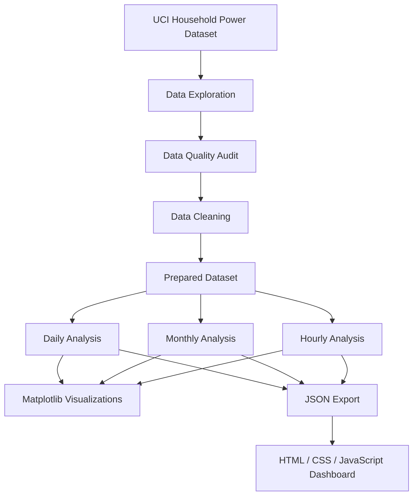
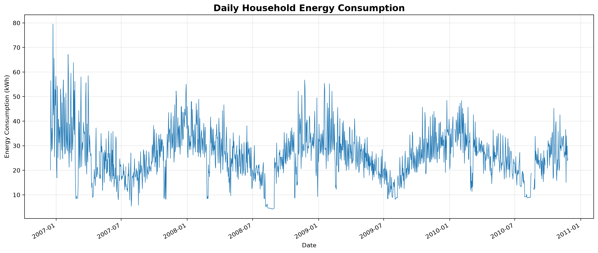
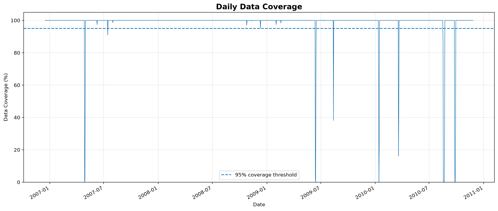
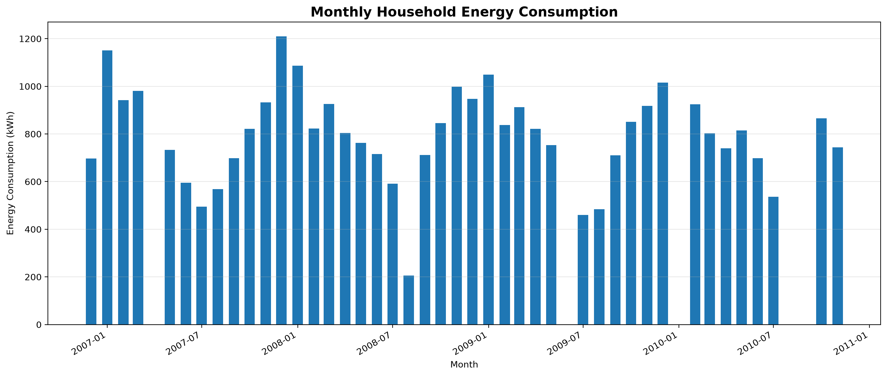
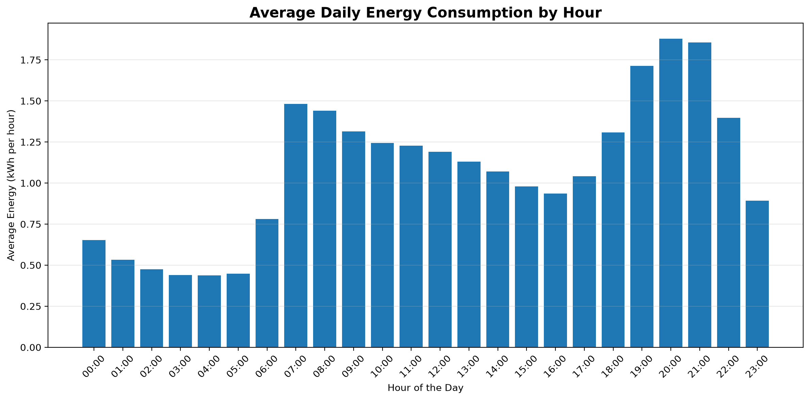

# Energy Consumption Analyzer

An end-to-end data analysis project focused on household electricity consumption. The project combines Python-based data processing, statistical analysis, scientific visualizations, and an interactive web dashboard.

## Project Overview

This project analyzes real-world electricity consumption data collected from a household in Sceaux, France, between December 2006 and November 2010.

The objective is to identify consumption patterns, analyze data quality, study daily and monthly trends, and present the results through an interactive dashboard.

## Dataset

**Source:** [UCI Machine Learning Repository — Individual Household Electric Power Consumption](https://archive.ics.uci.edu/dataset/235/individual+household+electric+power+consumption)

- Records: 2,075,259
- Sampling frequency: 1 minute
- Period: December 2006 – November 2010
- Original variables: 9
- Missing measurement rows: 25,979 (1.25%)

Missing measurements were preserved as NaN values. No artificial values or synthetic observations were introduced.

## Project Architecture



## Technologies

| Technology | Purpose |
|---|---|
| Python | Data processing and analysis |
| Pandas | Data cleaning and manipulation |
| Matplotlib | Scientific visualizations |
| HTML5 | Dashboard structure |
| CSS3 | Dashboard styling |
| JavaScript | Interactive dashboard |
| Chart.js | Interactive charts |
| Git / GitHub | Version control and source hosting |

## Data Analysis Results

### 1. Data Quality

- Total records: 2,075,259
- Missing measurement rows: 25,979
- Missing data percentage: 1.25%
- Missing intervals identified: 71
- Longest missing interval: approximately 120.43 hours
- Duplicate records: none detected

### 2. Daily Consumption





### 3. Monthly Consumption



### 4. Hourly Consumption



## Key Findings

- Average active power: approximately 1.09 kW.
- Average daily energy consumption: approximately 26.19 kWh.
- Average data coverage: approximately 98.75%.
- Highest average consumption occurs around 20:00.
- Lowest average consumption occurs around 04:00.

Daily and monthly energy calculations account for data coverage. Incomplete periods are retained for quality analysis rather than automatically filled with estimated values.

## Interactive Dashboard

The dashboard provides:

- Energy consumption KPIs.
- Daily consumption trends with selectable time ranges.
- Monthly consumption comparison.
- Hourly consumption profile.
- Data coverage monitoring.
- Automatic analytical insights.

### Dashboard Technologies

HTML, CSS, JavaScript and Chart.js.

## Project Structure

```text
01-Energy-Consumption-Analyzer/
│
├── dashboard/
│   ├── data/
│   │   ├── daily.json
│   │   ├── monthly.json
│   │   └── hourly.json
│   ├── index.html
│   ├── style.css
│   └── app.js
│
├── data/
│   ├── raw/
│   └── processed/
│
├── results/
│   ├── figures/
│   ├── daily_energy.csv
│   ├── monthly_energy.csv
│   ├── hourly_energy.csv
│   ├── cleaning_audit.txt
│   ├── exploration_report.txt
│   └── missing_periods.csv
│
├── src/
│   ├── explore_data.py
│   ├── audit_cleaning.py
│   ├── analyze_missing_periods.py
│   ├── prepare_data.py
│   ├── daily_analysis.py
│   ├── monthly_analysis.py
│   ├── hourly_analysis.py
│   ├── export_dashboard_data.py
│   └── visualize_data.py
│
├── .gitignore
├── requirements.txt
└── README.md
```

## Installation and Execution

### 1. Clone the repository

```bash
git clone YOUR_GITHUB_REPOSITORY_URL
cd 01-Energy-Consumption-Analyzer
```

### 2. Create a virtual environment

```bash
python -m venv .venv
```

Activate it on Windows:

```powershell
.\.venv\Scripts\Activate.ps1
```

### 3. Install dependencies

```bash
pip install -r requirements.txt
```

### 4. Download the dataset

Download the original dataset from the UCI Machine Learning Repository.

Extract `household_power_consumption.txt` into:

```text
data/raw/
```

### 5. Run the analysis scripts

Execute the scripts from the project root in the following order:

```bash
python src/explore_data.py
python src/audit_cleaning.py
python src/analyze_missing_periods.py
python src/prepare_data.py
python src/daily_analysis.py
python src/monthly_analysis.py
python src/hourly_analysis.py
python src/visualize_data.py
python src/export_dashboard_data.py
```

### 6. Run the dashboard locally

```powershell
cd dashboard
python -m http.server 8000 --bind 127.0.0.1
```

Open:

```text
http://127.0.0.1:8000/
```

## Project Status

**Completed:** Data exploration, quality auditing, preprocessing, daily/monthly/hourly analysis, Matplotlib visualizations, and interactive dashboard.

**Next steps:** GitHub publication and Netlify deployment.

---

**Author:** Samy Dries  
**Field:** Automation and Industrial Computing  
**Project:** 90 Projects Zero to Hero
